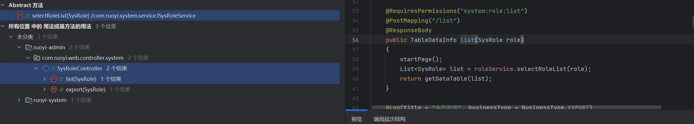

# 简述

RuoYi-4.6.1及其以下版本存在多个sql注入漏洞。涉及角色管理、用户管理、部门管理等模块。漏洞根因为 MyBatis XML Mapper中使用了 ${}字符串拼接语法将 `params `中的用户可控值直接拼入 SQL 语句，而非使用  `#{}`预编译占位符。攻击者登录后台后，通过构造恶意的 `params[dataScope]` 或 `ancestors`参数，即可实现数据窃取、数据篡改等恶意操作。

# 源码分析及其漏洞复现

本地部署并且启动ruoyi-4.6.1，详细教程请参考官网，这里不过多赘述。

## 1. /system/role/list 接口

在 SysRoleMapper.xml 的 selectRoleList 查询语句中，SQL 末尾存在一处直接拼接用户输入的逻辑。

```xml showLineNumbers startLineNumber=58 title="SysRoleMapper.xml"
${params.dataScope}
```

params来自于SysRole类

```xml showLineNumbers startLineNumber=36 title="SysRoleMapper.xml"
<select id="selectRoleList" parameterType="SysRole" resultMap="SysRoleResult">
```

然而在SysRole.java代码里并没有发现params属性，不过发现其继承了BaseEntity基类

```java showLineNumbers startLineNumber=15 title="SysRole.java"
public class SysRole extends BaseEntity
```

在BaseEntity基类找到params，是一个Map集合，这就是我们要操控的地方了，我们需要在这个Map里存放一个键值对，键名为dataScope，值是我们构造的恶意语句。

```java showLineNumbers startLineNumber=38 title="BaseEntity.java"
    /** 请求参数 */
    private Map<String, Object> params;
```

找到SysRoleMapper.xml对应的Mapper接口，即SysRoleMapper.java，找到里面的selectRoleList方法。

```java showLineNumbers startLineNumber=19 title="SysRoleMapper.java"
    public List<SysRole> selectRoleList(SysRole role);
```

ctrl+左键，跳转到selectRoleList方法的调用处，只有一处调用，位于SysRoleServiceImpl类的selectRoleList方法里

```java showLineNumbers startLineNumber=53 title="SysRoleServiceImpl.java"
    @Override
    @DataScope(deptAlias = "d")
    public List<SysRole> selectRoleList(SysRole role)
    {
        return roleMapper.selectRoleList(role);
    }
```

继续向上追踪，发现有三处调用，其中我们要分析的是SysRoleController类下的list方法，对应的路由正是/system/role/list。



list(SysRole role) 直接接收 SysRole 对象作为参数，Spring MVC 会自动将 HTTP请求参数按名称匹配，绑定到该对象的属性字段上，也就是说params完全可控。由RequiresPermissions注解知我们得先有system:role:list权限才能调用该接口。

```java showLineNumbers startLineNumber=53 title="SysRoleController.java"
    @RequiresPermissions("system:role:list")
    @PostMapping("/list")
    @ResponseBody
    public TableDataInfo list(SysRole role)
    {
        startPage();
        List<SysRole> list = roleService.selectRoleList(role);
        return getDataTable(list);
    }
```

